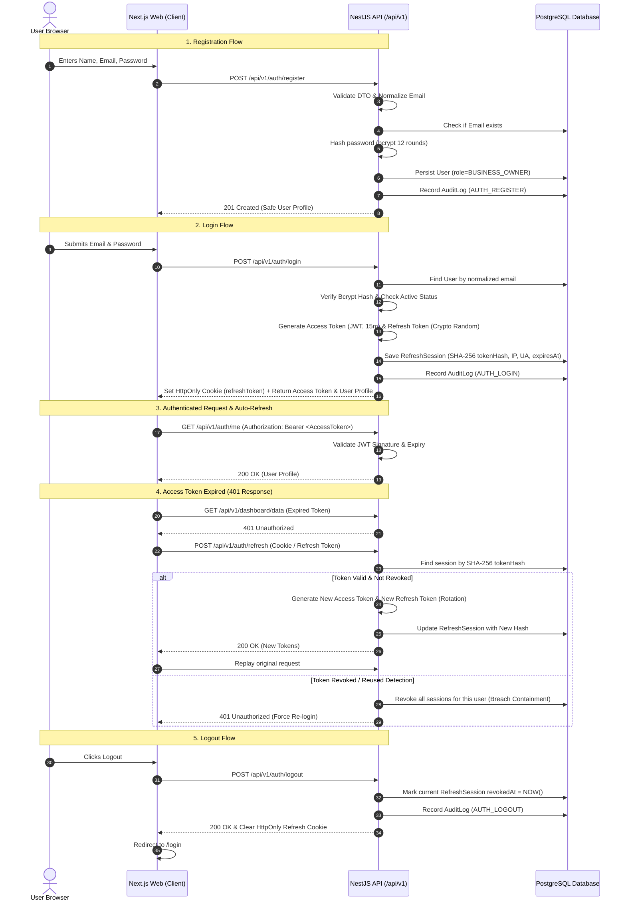

# Authentication & Session Management Flow

## 1. Authentication Lifecycle Diagram

## 2. Key Security Properties

1. **Short-Lived Access Tokens**:
   - 15 minutes validity limit prevents window of exposure if intercepted.
2. **Refresh Token Rotation & Invalidation**:
   - Each refresh request issues a new token pair and invalidates the previous token.
   - If an already-rotated token is presented again (token reuse), the system marks all sessions for that user as revoked immediately as an automated breach containment measure.
3. **Transport Security**:
   - Refresh tokens are transmitted via `HttpOnly`, `SameSite=Lax` cookies (and optionally via request body for mobile/CLI compatibility).
   - In production environments, the `Secure` attribute is strictly enforced.
4. **Credential Isolation**:
   - Password hashes are excluded from all Prisma default selection returns for public/safe user DTOs.
