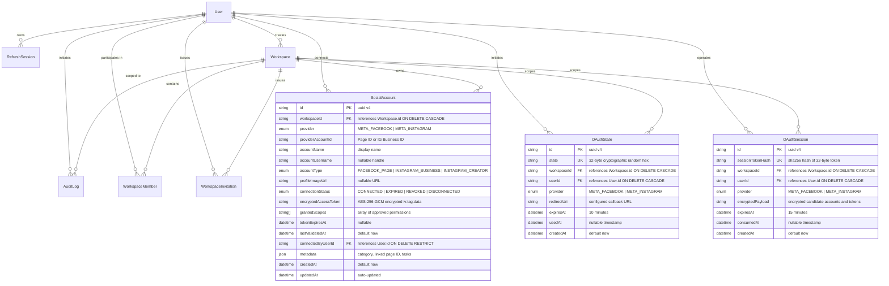

# Database Design & Data Models

## 1. Relational Entity Diagram (Stage 1, 2 & 3)

## 2. Table Specifications

### 2.1 `SocialAccount`
* `id` (`String`, UUID v4, Primary Key): Unique social account identifier.
* `workspaceId` (`String`, Foreign Key -> `Workspace.id` on delete cascade).
* `provider` (`SocialProvider` enum: `META_FACEBOOK`, `META_INSTAGRAM`).
* `providerAccountId` (`String`): Official provider identifier (Facebook Page ID or Instagram Business Account ID).
* `accountName` (`String`): Public display name.
* `accountUsername` (`String`, Nullable): Handle or username.
* `accountType` (`SocialAccountType` enum: `FACEBOOK_PAGE`, `INSTAGRAM_BUSINESS`, `INSTAGRAM_CREATOR`).
* `profileImageUrl` (`String`, Nullable): Avatar or profile photo URL.
* `connectionStatus` (`SocialConnectionStatus` enum: `CONNECTED`, `EXPIRED`, `REVOKED`, `DISCONNECTED`).
* `encryptedAccessToken` (`String`): AES-256-GCM ciphertext containing IV, authTag, and encrypted token. Plaintext tokens are never stored.
* `grantedScopes` (`String[]`): Array of OAuth permissions granted for this account.
* `tokenExpiresAt` (`DateTime`, Nullable): Token expiration timestamp.
* `lastValidatedAt` (`DateTime`): Timestamp of the last successful token verification.
* `connectedByUserId` (`String`, Foreign Key -> `User.id` on delete restrict).
* `metadata` (`Json`, Nullable): Provider-specific metadata (category, permissions, linked Facebook Page ID).
* Unique Constraint: `@@unique([workspaceId, provider, providerAccountId])`.

### 2.2 `OAuthState`
* `id` (`String`, UUID v4, Primary Key).
* `state` (`String`, Unique): Cryptographic 32-byte random hex string.
* `workspaceId` (`String`, Foreign Key -> `Workspace.id` on delete cascade).
* `userId` (`String`, Foreign Key -> `User.id` on delete cascade).
* `provider` (`SocialProvider` enum).
* `redirectUri` (`String`): Verified redirect URI.
* `expiresAt` (`DateTime`): 10 minutes from creation.
* `usedAt` (`DateTime`, Nullable): Single-use timestamp marking state as consumed.

### 2.3 `OAuthSession`
* `id` (`String`, UUID v4, Primary Key).
* `sessionTokenHash` (`String`, Unique): SHA-256 hash of single-use selection token.
* `workspaceId` (`String`, Foreign Key -> `Workspace.id` on delete cascade).
* `userId` (`String`, Foreign Key -> `User.id` on delete cascade).
* `provider` (`SocialProvider` enum).
* `encryptedPayload` (`String`): Encrypted JSON string holding candidate account metadata and page access tokens.
* `expiresAt` (`DateTime`): 15 minutes from creation.
* `consumedAt` (`DateTime`, Nullable): Timestamp when selection was finalized.

## 3. Indexing Strategy

1. `social_accounts_workspaceId_idx` on `SocialAccount(workspaceId)`: Rapid multi-tenant account lookups.
2. `social_accounts_provider_providerAccountId_idx` on `SocialAccount(provider, providerAccountId)`: Fast cross-workspace lookup for duplicate channel detection.
3. `oauth_states_state_idx` on `OAuthState(state)`: Instant OAuth callback state validation.
4. `oauth_sessions_sessionTokenHash_idx` on `OAuthSession(sessionTokenHash)`: Fast selection session retrieval.
