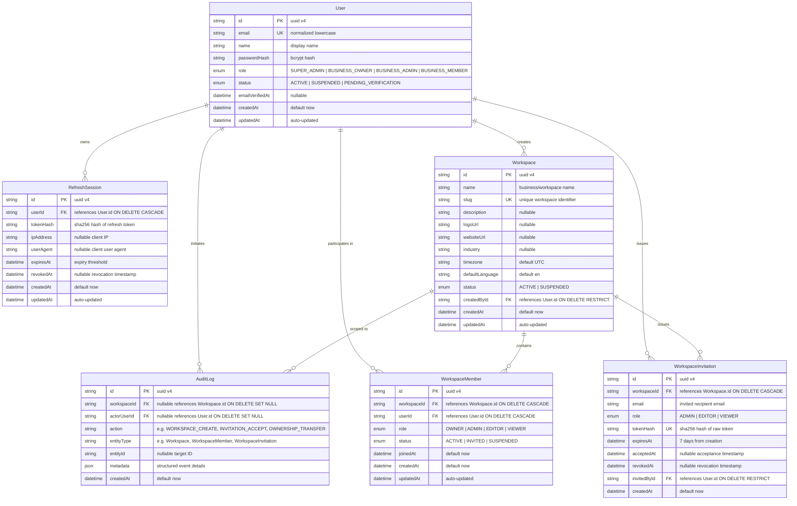

# Database Design & Data Models

## 1. Relational Entity Diagram (Stage 1 & Stage 2)

## 2. Table Specifications

### 2.1 `User`
* `id` (`String`, UUID v4, Primary Key): Globally unique identifier.
* `email` (`String`, Unique Index, Lowercase Normalized): User login identifier.
* `name` (`String`, Max 100): User display name.
* `passwordHash` (`String`): Bcrypt salted hash (12 rounds). Never exposed in DTO responses.
* `role` (`Role` enum): Platform authorization level (`SUPER_ADMIN`, `BUSINESS_OWNER`, `BUSINESS_ADMIN`, `BUSINESS_MEMBER`).
* `status` (`UserStatus` enum): Account state (`ACTIVE`, `SUSPENDED`, `PENDING_VERIFICATION`).
* `emailVerifiedAt` (`DateTime`, Nullable): Timestamp of email verification confirmation.
* `createdAt` / `updatedAt` (`DateTime`): Timestamps for auditing.

### 2.2 `Workspace`
* `id` (`String`, UUID v4, Primary Key): Workspace tenant identifier.
* `name` (`String`): Human-readable workspace/business name.
* `slug` (`String`, Unique): Unique URL and multi-tenant identifier.
* `description` (`String`, Nullable): Business description.
* `logoUrl` (`String`, Nullable): Logo image URL.
* `websiteUrl` (`String`, Nullable): Business website.
* `industry` (`String`, Nullable): Business sector or focus.
* `timezone` (`String`, Default `'UTC'`): Operational timezone for posting schedules.
* `defaultLanguage` (`String`, Default `'en'`): Workspace locale.
* `status` (`WorkspaceStatus` enum: `ACTIVE`, `SUSPENDED`).
* `createdById` (`String`, Foreign Key -> `User.id` on delete restrict).

### 2.3 `WorkspaceMember`
* `id` (`String`, UUID v4, Primary Key): Membership record identifier.
* `workspaceId` (`String`, Foreign Key -> `Workspace.id` on delete cascade).
* `userId` (`String`, Foreign Key -> `User.id` on delete cascade).
* `role` (`WorkspaceRole` enum: `OWNER`, `ADMIN`, `EDITOR`, `VIEWER`).
* `status` (`WorkspaceMemberStatus` enum: `ACTIVE`, `INVITED`, `SUSPENDED`).
* `joinedAt` (`DateTime`, Default `now()`): When the user joined the workspace.
* Unique Constraint: `(workspaceId, userId)`.

### 2.4 `WorkspaceInvitation`
* `id` (`String`, UUID v4, Primary Key).
* `workspaceId` (`String`, Foreign Key -> `Workspace.id` on delete cascade).
* `email` (`String`): Normalized invited email address.
* `role` (`WorkspaceRole` enum: `ADMIN`, `EDITOR`, `VIEWER`).
* `tokenHash` (`String`, Unique): Cryptographic SHA-256 hash of single-use invitation token.
* `expiresAt` (`DateTime`): Token expiration timestamp (7 days).
* `acceptedAt` (`DateTime`, Nullable): Timestamp when invitation was claimed.
* `revokedAt` (`DateTime`, Nullable): Timestamp when invitation was revoked.
* `invitedById` (`String`, Foreign Key -> `User.id` on delete restrict).

### 2.5 `AuditLog`
* `id` (`String`, UUID v4, Primary Key).
* `workspaceId` (`String`, Nullable, Foreign Key -> `Workspace.id` on delete set null).
* `actorUserId` (`String`, Nullable, Foreign Key -> `User.id` on delete set null).
* `action` (`String`, Indexed): Descriptive action tag (`WORKSPACE_CREATE`, `WORKSPACE_UPDATE`, `MEMBER_ROLE_UPDATE`, `MEMBER_REMOVE`, `OWNERSHIP_TRANSFER`, `INVITATION_CREATE`, `INVITATION_ACCEPT`, `INVITATION_REVOKE`).
* `entityType` (`String`): Entity subject (`Workspace`, `WorkspaceMember`, `WorkspaceInvitation`).
* `entityId` (`String`, Nullable): Identifier of affected entity.
* `metadata` (`Json`): Key-value context strictly sanitized of tokens and passwords.
* `createdAt` (`DateTime`, Indexed): Event timestamp.

## 3. Indexing Strategy

1. `users_email_idx` on `User(email)`: Instant lookups during authentication.
2. `workspaces_slug_idx` on `Workspace(slug)`: Instant tenant slug lookups.
3. `workspace_members_workspace_user_idx` on `WorkspaceMember(workspaceId, userId)`: Fast authorization guard checks.
4. `workspace_invitations_token_hash_idx` on `WorkspaceInvitation(tokenHash)`: Fast invitation verification.
5. `audit_logs_workspace_created_idx` on `AuditLog(workspaceId, createdAt)`: Rapid tenant audit queries.
