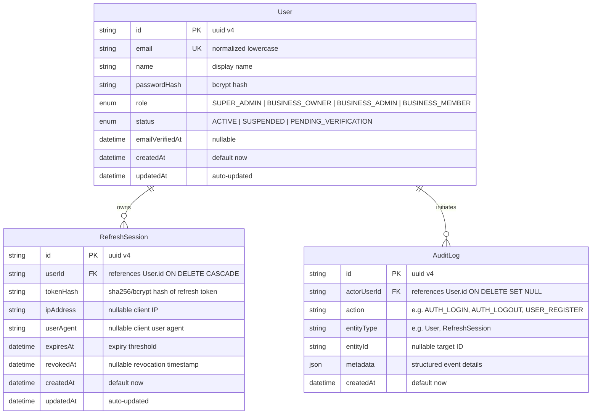

# Database Design & Data Models

## 1. Relational Entity Diagram (Stage 1)

## 2. Table Specifications

### 2.1 `User`
* `id` (`String`, UUID v4, Primary Key): Globally unique identifier.
* `email` (`String`, Unique Index, Lowercase Normalized): User login identifier.
* `name` (`String`, Max 100): User display name.
* `passwordHash` (`String`): Bcrypt salted hash (12 rounds). Never exposed in DTO responses.
* `role` (`Role` enum): Platform authorization level (`SUPER_ADMIN`, `BUSINESS_OWNER`, `BUSINESS_ADMIN`, `BUSINESS_MEMBER`).
* `status` (`UserStatus` enum): Account state (`ACTIVE`, `SUSPENDED`, `PENDING_VERIFICATION`).
* `emailVerifiedAt` (`DateTime`, Nullable): Timestamp of email verification confirmation.
* `createdAt` / `updatedAt` (`DateTime`): Timestamps for auditing.

### 2.2 `RefreshSession`
* `id` (`String`, UUID v4, Primary Key): Session ID.
* `userId` (`String`, Foreign Key -> `User.id` on delete cascade).
* `tokenHash` (`String`, Indexed): SHA-256 hash of the generated refresh token. The raw token is never persisted.
* `ipAddress` (`String`, Nullable): Request IP origin for security tracking.
* `userAgent` (`String`, Nullable): Request User-Agent for device identification.
* `expiresAt` (`DateTime`): Timestamp after which the token is invalid (7 days).
* `revokedAt` (`DateTime`, Nullable): If populated, indicates session was explicitly revoked or invalidated via token reuse detection.

### 2.3 `AuditLog`
* `id` (`String`, UUID v4, Primary Key).
* `actorUserId` (`String`, Nullable, Foreign Key -> `User.id` on delete set null).
* `action` (`String`, Indexed): Descriptive action tag (`AUTH_REGISTER`, `AUTH_LOGIN`, `AUTH_LOGOUT`, `ROLE_UPDATE`).
* `entityType` (`String`): Entity subject (`User`, `RefreshSession`, etc.).
* `entityId` (`String`, Nullable): Identifier of affected entity.
* `metadata` (`Json`): Key-value context (IP, User Agent, status) strictly sanitized of passwords and secret keys.
* `createdAt` (`DateTime`, Indexed): Event timestamp.

## 3. Indexing Strategy

1. `users_email_idx` on `User(email)`: Ensures instant lookups during authentication.
2. `refresh_sessions_user_id_idx` on `RefreshSession(userId)`: Fast session retrieval for user session list and bulk logout.
3. `refresh_sessions_token_hash_idx` on `RefreshSession(tokenHash)`: Constant-time refresh token lookup.
4. `audit_logs_actor_created_idx` on `AuditLog(actorUserId, createdAt)`: Rapid compliance filtering.
