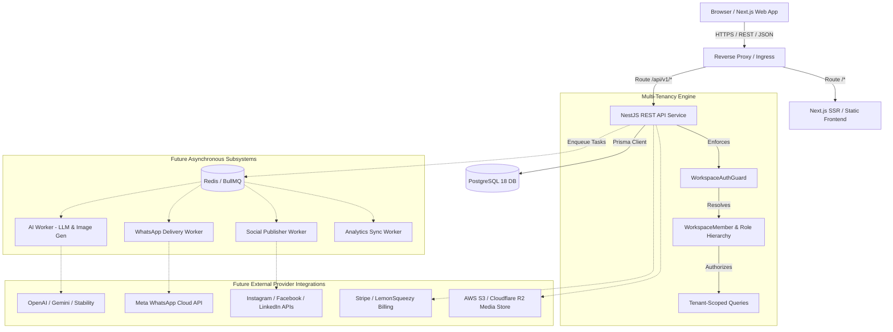

# System Architecture

## 1. High-Level Architecture Diagram



## 2. Request Lifecycle & Layered Responsibilities

1. **Client Tier (`apps/web`)**:
   - Built on Next.js App Router with TypeScript and Tailwind CSS.
   - Client-side data fetching via centralized `apiClient` (`src/lib/api-client.ts`).
   - Authentication session state managed via `AuthContext` with automatic token refresh on `401 Unauthorized`.
   - Multi-tenant workspace state managed via `WorkspaceContext` (`src/lib/workspace-context.tsx`).
   - Header workspace switcher allows switching active context; every API call is independently authorized on the backend.

2. **API Tier (`apps/api`)**:
   - Built on NestJS adhering to modular domain architecture.
   - Versioned prefix `/api/v1`.
   - Global `ValidationPipe` with `whitelist: true` and `forbidNonWhitelisted: true`.
   - Global `HttpExceptionFilter` ensuring RFC 7807 compliant standardized JSON error payloads.
   - Global `LoggingInterceptor` injecting `X-Correlation-Id` headers and measuring execution latencies.
   - Authentication guard: `JwtAuthGuard` checks Bearer token or HttpOnly cookie.
   - Tenant isolation guard: `WorkspaceAuthGuard` intercepts workspace-scoped endpoints (`/workspaces/:workspaceId/*`), verifies the caller has active membership in the target workspace, and validates role hierarchy against `@RequireWorkspaceRole(...)`.

3. **Persistence Tier (`PostgreSQL + Prisma`)**:
   - PostgreSQL as the single source of truth for all users, auth sessions, workspaces, memberships, invitations, and audit trails.
   - Prisma ORM manages type-safe data access and deterministic schema migrations (`prisma/migrations`).
   - All workspace operations run within explicit `$transaction` boundaries to guarantee ACID compliance (e.g., creating a workspace atomically creates the OWNER member and audit log; accepting an invitation atomically binds the member, invalidates the invite token, and writes an audit log).

## 3. Multi-Tenancy & Tenant Isolation Architecture

### Core Relational Hierarchy
```
User (Platform Account)
  └── WorkspaceMember (Membership & Role: OWNER, ADMIN, EDITOR, VIEWER)
        └── Workspace (Tenant Domain)
              └── Workspace-Owned Resources (Posts, Channels, Campaigns)
```

### Security Controls & IDOR Prevention
1. **No Client Trust**: Client-supplied `createdById`, member IDs, or platform roles are discarded. All actor identities are derived directly from the verified JWT payload (`req.user.id`).
2. **Path Scoping**: Every workspace route takes `:workspaceId` and verifies that the caller belongs to that exact workspace.
3. **Role Hierarchy Enforcement**:
   - `OWNER` (rank 4): Full settings, membership, invite, transfer-ownership.
   - `ADMIN` (rank 3): Settings, invite, member management (cannot demote/remove OWNER or modify other ADMINs).
   - `EDITOR` (rank 2): Content creation and editing; read-only settings.
   - `VIEWER` (rank 1): Read-only workspace inspection.
4. **Final Owner Protection**: The workspace `OWNER` cannot be deleted or removed. Ownership can only be transferred to an active member via the dedicated `/transfer-ownership` transactional endpoint.
5. **No ID Enumeration**: When a user attempts to access a workspace where they have no membership, `403 Forbidden` or `404 Not Found` is returned consistently.

## 4. Cryptographic Invitation Lifecycle
1. **Creation**: An administrator initiates an invitation with an email and role (`ADMIN`, `EDITOR`, or `VIEWER`).
2. **Token Generation**: A cryptographically random 32-byte hex token (`crypto.randomBytes(32)`) is generated.
3. **Hashing**: Only the SHA-256 hash of the token (`tokenHash`) is persisted in PostgreSQL. The raw token is never stored in the database.
4. **Expiration & Single-Use**: Invitations expire in 7 days (`expiresAt`). Upon acceptance, `acceptedAt` is recorded atomically; subsequent attempts to use the same token are rejected (`409 Conflict` or `400 Bad Request`).
5. **Revocation**: Administrators can revoke pending invitations at any time (`POST /workspaces/:workspaceId/invitations/:invitationId/revoke`).
6. **Honest Development Mode**: When no production SMTP provider is configured, the API returns the token and invitation link directly in development mode responses so developers and QA can immediately copy and test acceptance flows.
