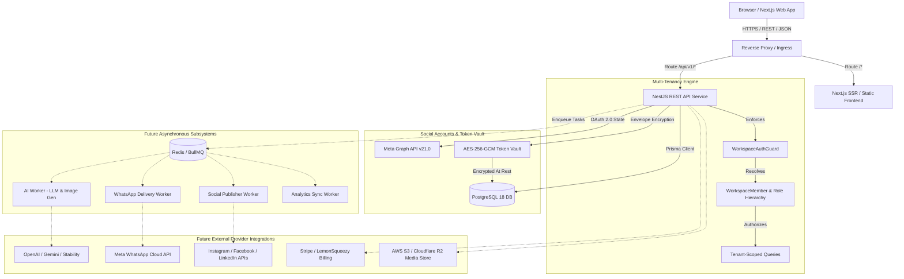

# System Architecture

## 1. High-Level Architecture Diagram



## 2. Request Lifecycle & Layered Responsibilities

1. **Client Tier (`apps/web`)**:
   - Built on Next.js App Router with TypeScript and Tailwind CSS.
   - Client-side data fetching via centralized `apiClient` (`src/lib/api-client.ts`).
   - Authentication session state managed via `AuthContext` with automatic token refresh on `401 Unauthorized`.
   - Multi-tenant workspace state managed via `WorkspaceContext` (`src/lib/workspace-context.tsx`).
   - Header workspace switcher allows switching active context; every API call is independently authorized on the backend.

2. **API Tier (`apps/api`)**:
   - Built on NestJS adhering to modular domain architecture.
   - Versioned prefix `/api/v1`.
   - Global `ValidationPipe` with `whitelist: true` and `forbidNonWhitelisted: true`.
   - Global `HttpExceptionFilter` ensuring RFC 7807 compliant standardized JSON error payloads.
   - Global `LoggingInterceptor` injecting `X-Correlation-Id` headers and measuring execution latencies.
   - Authentication guard: `JwtAuthGuard` checks Bearer token or HttpOnly cookie.
   - Tenant isolation guard: `WorkspaceAuthGuard` intercepts workspace-scoped endpoints (`/workspaces/:workspaceId/*`), verifies the caller has active membership in the target workspace, and validates role hierarchy against `@RequireWorkspaceRole(...)`.

3. **Persistence Tier (`PostgreSQL + Prisma`)**:
   - PostgreSQL as the single source of truth for all users, auth sessions, workspaces, memberships, invitations, social accounts, and audit trails.
   - Prisma ORM manages type-safe data access and deterministic schema migrations (`prisma/migrations`).
   - All workspace operations run within explicit `$transaction` boundaries to guarantee ACID compliance.

## 3. Multi-Tenancy & Tenant Isolation Architecture

### Core Relational Hierarchy
```
User (Platform Account)
  └── WorkspaceMember (Membership & Role: OWNER, ADMIN, EDITOR, VIEWER)
        └── Workspace (Tenant Domain)
              ├── SocialAccount (Encrypted Credentials & Metadata)
              ├── OAuthState (Replay Protection)
              └── OAuthSession (Candidate Store)
```

### Security Controls & IDOR Prevention
1. **No Client Trust**: Client-supplied `createdById`, member IDs, or platform roles are discarded. All actor identities are derived directly from the verified JWT payload (`req.user.id`).
2. **Path Scoping**: Every workspace route takes `:workspaceId` and verifies that the caller belongs to that exact workspace.
3. **Role Hierarchy Enforcement**:
   - `OWNER` (rank 4): Full settings, membership, invite, transfer-ownership, social channels.
   - `ADMIN` (rank 3): Settings, invite, member management, connect/disconnect social channels.
   - `EDITOR` (rank 2): Content creation; read-only settings & channels.
   - `VIEWER` (rank 1): Read-only workspace inspection.
4. **Final Owner Protection**: The workspace `OWNER` cannot be deleted or removed. Ownership can only be transferred to an active member via the dedicated `/transfer-ownership` transactional endpoint.
5. **No ID Enumeration**: When a user attempts to access a workspace where they have no membership, `403 Forbidden` or `404 Not Found` is returned consistently.

## 4. Cryptographic Invitation Lifecycle
1. **Creation**: An administrator initiates an invitation with an email and role (`ADMIN`, `EDITOR`, or `VIEWER`).
2. **Token Generation**: A cryptographically random 32-byte hex token (`crypto.randomBytes(32)`) is generated.
3. **Hashing**: Only the SHA-256 hash of the token (`tokenHash`) is persisted in PostgreSQL. The raw token is never stored in the database.
4. **Expiration & Single-Use**: Invitations expire in 7 days (`expiresAt`). Upon acceptance, `acceptedAt` is recorded atomically; subsequent attempts to use the same token are rejected (`409 Conflict` or `400 Bad Request`).
5. **Revocation**: Administrators can revoke pending invitations at any time (`POST /workspaces/:workspaceId/invitations/:invitationId/revoke`).

## 5. Social Media Accounts, OAuth 2.0 & Token Vault Architecture (Stage 3)

### Meta Graph API (v21.0) Integration
* **Supported Channel Types**:
  1. **Facebook Pages**: Brand/business pages administered by the authorized user.
  2. **Instagram Professional Accounts**: Business or Creator accounts linked to administered Facebook Pages.
* **Required Scopes**:
  - `pages_show_list`: Discover administered Facebook Pages.
  - `pages_read_engagement`: Read engagement metrics and post interactions.
  - `pages_manage_posts`: Publish and manage posts on behalf of the Facebook Page.
  - `instagram_basic`: Read profile info and media for linked Instagram accounts.
  - `instagram_content_publish`: Publish feed photos, carousels, and reels to Instagram.

### OAuth 2.0 Sequence & State Validation
1. **Initiation**: User clicks "Connect Channel" in a workspace.
2. **State Generation**: Backend generates a 32-byte cryptographically random hex token (`crypto.randomBytes(32)`), stores it in `OAuthState` with a 10-minute expiration, and binds it to `workspaceId`, `userId`, and `provider`.
3. **Provider Dialog**: User is redirected to `https://www.facebook.com/v21.0/dialog/oauth`.
4. **Callback Verification**: Provider redirects to `GET /api/v1/oauth/meta/callback?code=...&state=...`.
   - State is looked up in `OAuthState`: must exist, must not be used, must not be expired.
   - State is atomically marked `usedAt = now()` to prevent replay attacks.
5. **Server-Side Token Exchange**:
   - Backend exchanges authorization `code` for a short-lived user token.
   - Backend exchanges short-lived token for a 60-day long-lived user token (`grant_type=fb_exchange_token`).
   - Discovers Facebook Pages and associated Instagram accounts via `/me/accounts`.
6. **Ephemeral Candidate Session (`OAuthSession`)**:
   - Page tokens are never sent to the browser.
   - Candidates and page access tokens are encrypted with `TokenVaultService` and stored in `OAuthSession` (15-minute expiration).
   - User is redirected to the frontend channel selection view (`/settings/social-accounts/connect?session=...`).
7. **Account Selection**:
   - User reviews and selects desired accounts.
   - Backend retrieves candidate session, decrypts payload, encrypts individual page access tokens with AES-256-GCM, and upserts them into `SocialAccount`.
   - Access tokens are strictly omitted from all API responses.

### Credential Envelope Encryption (AES-256-GCM)
* **Algorithm**: Authenticated AES-256-GCM (Galois/Counter Mode).
* **Format**: `iv:authTag:ciphertext` (hex-encoded).
* **Initialization Vector (IV)**: 12-byte cryptographically random IV per encryption.
* **Authentication Tag**: 16-byte GCM authentication tag verifying ciphertext integrity and detecting any data tampering.
* **Key Configuration**: 32-byte hex key configured via `TOKEN_ENCRYPTION_KEY` in environment.
