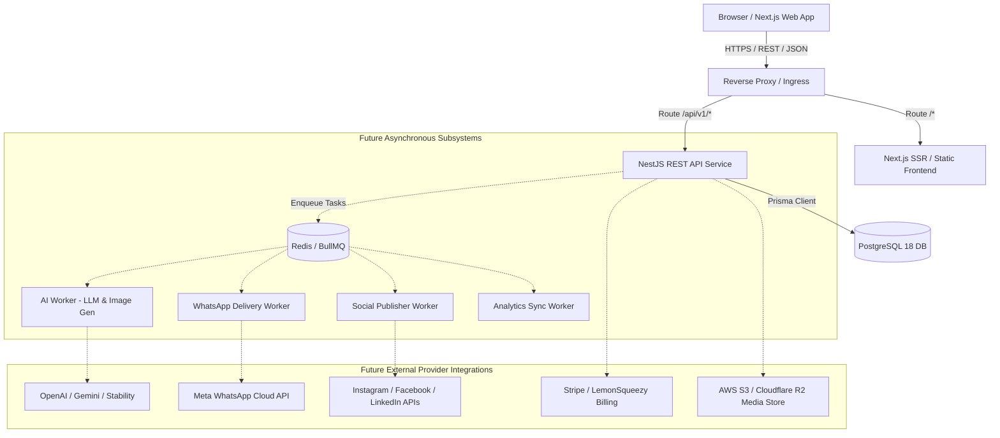

# System Architecture

## 1. High-Level Architecture Diagram

## 2. Request Lifecycle & Layered Responsibilities

1. **Client Tier (`apps/web`)**:
   - Built on Next.js App Router with TypeScript and Tailwind CSS.
   - Client-side data fetching via centralized `apiClient` (`src/lib/api-client.ts`).
   - Authentication session state managed via `AuthContext` with automatic token refresh on `401 Unauthorized`.
   - Never exposes backend secrets or private database credentials to the client.

2. **API Tier (`apps/api`)**:
   - Built on NestJS adhering to modular domain architecture.
   - Versioned prefix `/api/v1`.
   - Global `ValidationPipe` with `whitelist: true` and `forbidNonWhitelisted: true`.
   - Global `HttpExceptionFilter` ensuring RFC 7807 compliant standardized JSON error payloads.
   - Global `LoggingInterceptor` injecting `X-Correlation-Id` headers and measuring execution latencies.
   - Guard layer: `JwtAuthGuard` checks Bearer token or HttpOnly cookie, followed by `RolesGuard` validating RBAC permissions.

3. **Persistence Tier (`PostgreSQL + Prisma`)**:
   - PostgreSQL as the single source of truth for all users, auth sessions, workspace memberships, and audit trails.
   - Prisma ORM manages type-safe data access and deterministic schema migrations (`prisma/migrations`).
   - Database connection pools managed gracefully across application bootstrap and shutdown hooks.

## 3. Scalability & Operational Considerations

- **Stateless API**: NestJS backend instances maintain zero session state in local memory. Authentication is governed by cryptographic JWTs and database-persisted refresh token hashes.
- **Graceful Shutdown**: The API handles `SIGTERM` and `SIGINT` signals, closing HTTP listeners and Prisma connection pools gracefully without dropping inflight requests.
- **Health & Readiness**: 
  - `GET /api/v1/health`: Returns service uptime, timestamp, and process statistics.
  - `GET /api/v1/health/ready`: Performs a live `SELECT 1` query to PostgreSQL; returns HTTP 503 if the database is unreachable.
